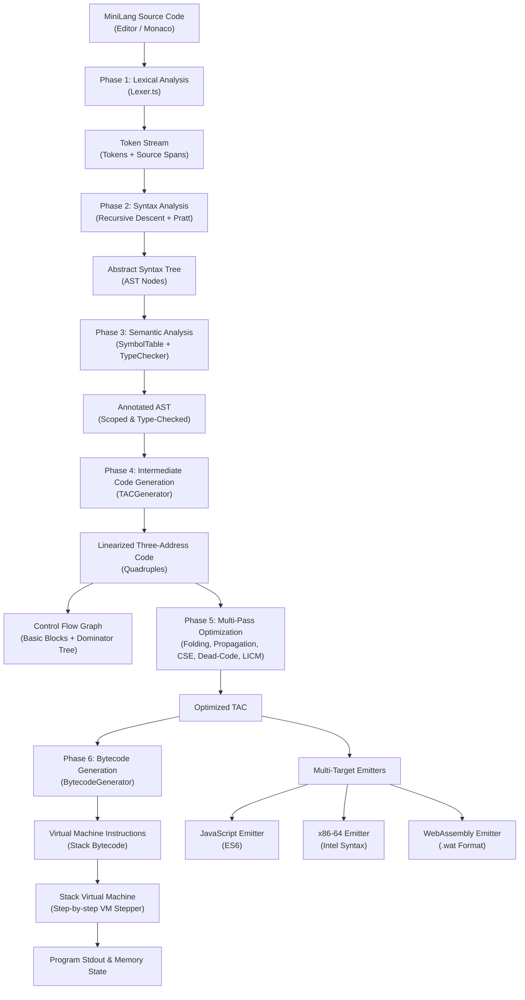
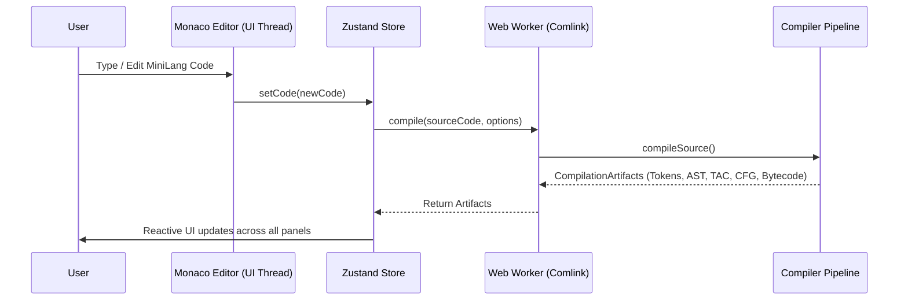
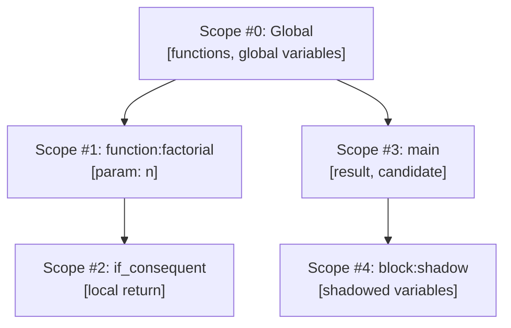
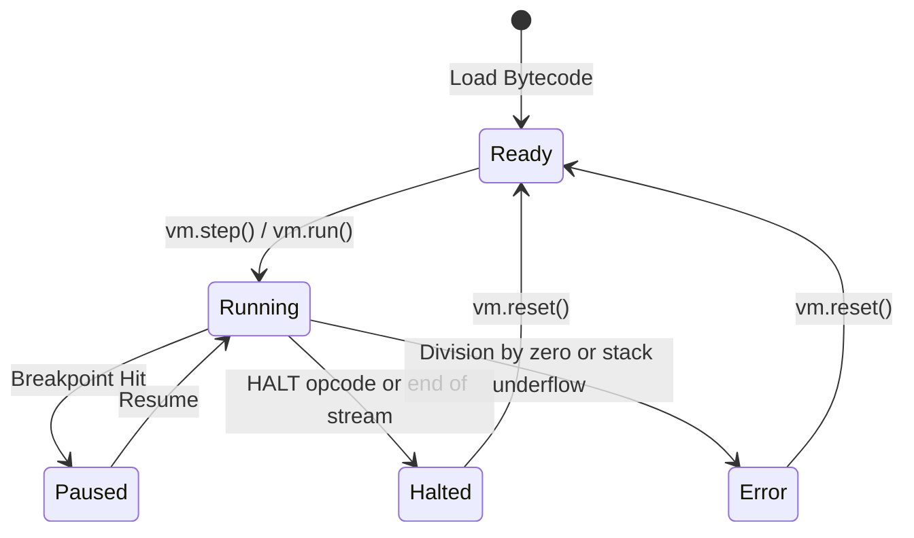

# CompilerLens System Architecture

## 1. End-to-End Compiler Pipeline

The diagram below illustrates the sequential transformation pipeline of CompilerLens:

---

## 2. Frontend & Web Worker Architecture

To guarantee zero UI latency, all CPU-intensive analysis runs in background Web Workers:

---

## 3. Scoped Symbol Table Hierarchy

MiniLang enforces lexical block scoping with support for inner variable shadowing:

---

## 4. Virtual Machine Step Execution Loop

---

## 5. Security & Privacy Guarantees

1. **Client-Side Execution**: All compiler phases, AST parsing, and VM simulations run 100% inside the user's web browser. Source code is never sent to a remote compiler server.
2. **Deterministic Fallbacks**: If the Anthropic Claude API key is absent, the offline rule-based explainer provides immediate feedback without network requests.
